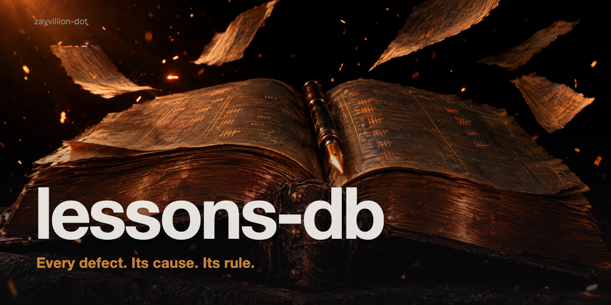

# Lessons DB



A Claude Code skill for the moment a review round closes. `LESSONS-DB.md` at the repo root is a running database of confirmed defects, each with its root cause and the one-line prevention rule it taught, plus the review artefacts that produced them. Without the skill, the agent leaves review output in chat, summarises defects with no root cause or rule, and never looks at prior lessons.

Use it when a review round confirms or refutes findings, a review, audit or test pass is about to close, work starts in an area that has been reviewed before, you say "ledger it", "lessons db" or "what did we learn last time", or invoke `/lessons-db`.

Not for a single bug fix with no review behind it, or for a changelog (this records what a defect taught, not what shipped).

## Install

**As a plugin:**

```
/plugin marketplace add zayvillion-dot/lessons-db
/plugin install lessons-db@lessons-db
```

**Manual:**

Copy `skills/lessons-db/` into `~/.claude/skills/`.

## The rules

| Rule | Why |
|---|---|
| Ledger lives in the repo, committed at every round close | A scratchpad or chat can vanish |
| Round brief, reports, docket and probe output go to `docs/reviews/` | Evidence stays next to the code |
| One row per defect, with root cause and prevention rule | A lesson you can apply |
| Refuted findings are counted, not ledgered | Keeps the database true |
| Append and status-update only | History stays trustworthy |
| Read the rules before similar work, and say which apply | The payoff |

## The entry

| ID | Defect | Root cause | Prevention rule |
|---|---|---|---|

Each review gets a `## Review:` section, newest first, with Scope, Process (rounds, raised / confirmed / refuted) and Status (OPEN, PASSED, SHIPPED OVER OPEN FINDINGS).

Example row:

```
| D1 | Last page repeats the final item | Offset computed from 1-based page without subtracting 1 (round 1) | Test every pagination boundary: first, last, empty, exact multiple |
```

## Pairs with

[`jedi-review`](https://github.com/zayvillion-dot/jedi-review), the review skill this was built alongside. It works with any review process.

## Known gaps in 0.1.0

1. No clean RED baseline yet. The prompt for a clean run is in `docs/red-baseline-prompt.md`.
2. No search tooling; the ledger is read with grep.
3. Single-file ledger; very large histories will need splitting.

## License

MIT — see `LICENSE`.
